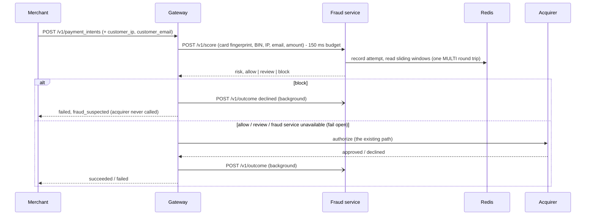

# Fraud detection: catching card testing in real time

Card testing is when a fraudster runs many stolen or guessed card numbers through a
merchant with tiny charges, to learn which cards are live before using them for real.
It looks like many small attempts, many different cards from the same source, and a high
decline rate, all within seconds or minutes.

This layer adds a fraud check to the payment simulator: the gateway asks a scoring
service about every payment **before** it reaches the acquirer, and blocks the ones that
look like card testing.

**Everything below is measured on synthetic data I generated.** It says nothing about
real-world fraud rates. See [Limitations](#limitations).



## Data

`python -m ml.generate_data` builds a 7-day stream of about 99k authorization attempts
from a fixed seed. Each row has a timestamp, an opaque card token, a BIN, amount, IP,
email, merchant and outcome. No card numbers are generated. Attacks are about 3.6% of rows.

| kind | what it looks like |
|---|---|
| `normal` | Customers with 1-2 cards and Poisson-timed purchases of about $5-$300 (lognormal). About 5% are declined, and about 3% are small ($0.50-$5). |
| `normal_retry` | After a decline, the customer retries the **same** card 1-3 times within a minute. |
| `normal_shared_ip` | Customers behind a few shared NAT or office IPs. |
| `flash_sale` | A 10-minute rush at one merchant, with 30% of buyers on one mobile-carrier IP. It always falls in the test period, so **no model trains on it**. |
| `attack_burst` | One IP and email, 20-120 fresh cards in 1-5 minutes, mostly $0.50-$2, about 85% declined. |
| `attack_slow` | The same pattern spread over 1-2 hours. |
| `attack_rotating_ip` | A shared email and BIN, with the IP drawn from a proxy pool on each attempt. |
| `attack_rotating_identity` | A fresh email **and** a proxy IP per attempt. Only the BIN and merchant are shared. |

**How the data changed after I saw results.** This happened twice:
1. Every attack originally used $0.50-$2 and every normal purchase was at least $5, so the
   amount alone separated the classes. I made amounts overlap before training anything.
2. The first trained model scored **F1 about 0.98**, almost entirely from one feature
   (attempts per email in 60 s). I checked: it wasn't leakage. The generator gave every
   attack campaign a single email, which real card testers don't do. I added the
   `attack_rotating_identity` attacker and then stopped changing the data.

The second change was made *after looking at test results*, which is a mild form of
tuning to the test set. I'm stating it rather than hiding it.

## Features: one definition, two implementations

There are six sliding-window features plus the amount:

| feature | window |
|---|---|
| attempts per IP | 60 s |
| declines per IP | 60 s |
| distinct cards per IP | 5 min |
| decline rate per IP | 5 min |
| attempts per email | 60 s |
| attempts per BIN | 60 s |

They are computed in two places:
- **Offline** from the CSV for training (`ml/offline_features.py`).
- **Live** in Redis sorted sets for serving (`services/fraud/features.py`).

If the two ever disagree, the model is scored on inputs it never saw in training
(training/serving skew). Three things guard against that:
- **One definition.** The names and windows exist only in `services/fraud/features.py`.
- **A parity test.** Generated traffic is replayed through Redis, and every feature must
  match the offline value on every row. `python -m ml.check_parity` gave 0 mismatches over
  19,845 events against real Redis.
- **Window-edge tests.** I planted an off-by-one bug at the window edge, and the parity
  test **missed** it, because random millisecond timestamps almost never land exactly on
  the edge. A dedicated unit test caught it. In the other direction, parity caught a
  wrong window size (56 rows) that no unit test covered. You need both.

A payment's own outcome is never a feature. The scorer runs before the issuer decides, so
using it would leak the answer into training. Each payment touches Redis twice: once at
score time, and once after authorization to record a decline.

## Models and evaluation

- **Split by time, never randomly.** Train is the first 60% of the timeline, validation
  the next 10%, test the last 30%. A random split would put events from the same attack
  campaign on both sides.
- **Models.** Class-weighted logistic regression (log-scaled counts) and class-weighted
  gradient boosting (`HistGradientBoostingClassifier`), both on the 7 inputs.
- **Threshold.** The block threshold is the one that maximizes F1 on **validation**. The
  test set is never used for any choice.
- **No accuracy.** With 3.6% attacks, always answering "normal" scores 96% accuracy. The
  metrics are precision, recall, F1, and the **false-positive rate on normal events**,
  which is the cost to real customers.

## Results

**Headline, the seed-42 dataset's test slice** (30,472 events, 939 attack events in 15
campaigns; [`ml/results/results.md`](../ml/results/results.md)):

| method | precision | recall | F1 | false-positive rate | campaigns caught |
|---|---|---|---|---|---|
| rules baseline | 0.569 | 0.515 | 0.541 | 1.24% | 80% |
| logistic regression | 0.659 | 0.934 | 0.773 | 1.54% | 100% |
| gradient boosting | 0.962 | 0.944 | 0.953 | 0.12% | 100% |

**The same pipeline over five more dataset seeds** (mean ± sd, with the range;
[`ml/results/seeds.md`](../ml/results/seeds.md)):

| method | precision | recall | F1 | false-positive rate |
|---|---|---|---|---|
| rules baseline | 0.57 ± 0.07 | 0.50 ± 0.14 | 0.53 ± 0.11 (0.33-0.59) | 1.26% (1.20-1.36%) |
| logistic regression | 0.69 ± 0.06 | 0.87 ± 0.06 | 0.77 ± 0.05 (0.70-0.84) | 1.32% (1.11-1.52%) |
| gradient boosting | 0.84 ± 0.15 | 0.91 ± 0.03 | **0.87 ± 0.08 (0.74-0.96)** | 0.61% (0.06-1.39%) |

**Seed 42 is on the lucky end.** Gradient boosting beats the rules' F1 on every seed, and
its recall is stable (0.87-0.94). Its precision and false-positive rate are not: on one
seed it flags more normal customers than the rules do. The next section explains why.

Share of events flagged per scenario (seed 42):

| scenario | rules | logreg | gbm |
|---|---|---|---|
| attack_burst | 0.912 | 0.981 | 0.985 |
| attack_rotating_identity | 0.021 | 0.766 | 0.883 |
| attack_rotating_ip | 0.000 | 0.941 | 0.941 |
| attack_slow | 0.191 | 0.900 | 0.883 |
| flash_sale (normal) | 0.298 | 0.337 | 0.014 |
| normal_retry (normal) | 0.009 | 0.021 | 0.002 |

The rules only catch fast bursts. The models also catch rotating and slow attackers,
mostly through distinct cards per IP and attempts per email, the top two features by
permutation importance (0.28 and 0.21 drop in PR-AUC).

## Two failure cases

**1. The unseen flash sale.** No model ever trains on a flash sale. Gradient boosting
flagged only 1.4% of flash-sale buyers on seed 42, against 30% for the rules, and that
looked like the model's best result. On seed 3 it flagged **30.6%**, no better than the
rules (28.1%). On seed 4 it flagged 22.6%. Flash-sale buyers are 367 of seed 3's 409 false
positives. Whether the model happens to separate "many different people buying at one
merchant from one carrier IP" from "one actor cycling cards" depends on the draw, because
it has never seen the first case. A model can't learn a normal pattern it was never shown;
the answer is training data that includes such events, or features that tell them apart
(per-merchant baselines, account history).

**2. Slow attacks.** On seed 42, gradient boosting's three least-caught campaigns include
two slow ones: `c0046` (42 attempts, 79% caught) and `c0052` (58 attempts, 83%). Spread
over an hour or two, they barely register in 60-second windows. Only the 5-minute
distinct-cards window sees them. Longer windows, or a sequence model over each source's
history, would be the next step.

## In the payment path

- **Feature flag:** `FRAUD_CHECK_ENABLED`, off by default in code and on in Docker
  Compose. With it off, the gateway behaves exactly as before.
- **Decisions:**
  - `block` (risk ≥ the validation threshold, about 0.976) declines the payment as
    `fraud_suspected`, and the acquirer is never called.
  - `review` (risk ≥ 0.5) and `allow` go ahead.
- **Fail open:** the gateway gets one attempt with a 150 ms budget. On timeout, error, or
  a malformed reply, the payment continues unscored. The reasoning is in
  [`docs/decisions.md`](decisions.md).
- **What the fraud service sees:**
  - an HMAC fingerprint of the card. Vault tokens are random on every tokenize call, so
    they can't identify a card.
  - the BIN and a hash of the merchant's API key
  - the shopper's IP and email
  - **never** the card number or the API key

**Demo** (`python -m scripts.demo`, steps 5-6, on the Docker stack):

```
=== 5. Card-testing burst: one IP, a new card every attempt, $1 each ===
  attempt  1: card ...2146  fraud=review status=failed    reason=card_not_found
  attempt  2: card ...1684  fraud=block  status=failed    reason=fraud_suspected
  ...
  attempt 15: card ...4166  fraud=block  status=failed    reason=fraud_suspected
blocked 14/15 attempts before they reached the acquirer

=== 6. Meanwhile, a normal customer still gets through ===
  status=succeeded  fraud=review
```

The normal customer in step 6 gets `review`, not `allow`. That's **BIN spillover**: for
60 s after a burst on BIN 424242, a clean customer on that BIN scored 0.82, against 0.07
on another BIN. The per-BIN window can't tell the attacker's traffic from everyone else's.
Nobody was blocked, but it is a real cost to legitimate customers.

## Latency

Measured with `python -m scripts.fraud_latency` on Docker Desktop on one Windows machine
([`ml/results/latency.md`](../ml/results/latency.md)):

| | `/v1/score` p50 / p95 | payment p50, check off | payment p50, check on | the check adds (p50 / p95) |
|---|---|---|---|---|
| before connection pooling | 5.6 / 8.4 ms | 42.7 ms | 60.1 ms | +17.4 / +18.9 ms |
| after pooling | 4.8 / 6.4 ms | 20.0 ms | 28.3 ms | **+8.3 / +7.5 ms** |

The first version opened a new TCP connection for every service-to-service call. Pooling
connections in the shared HTTP helper halved the fraud check's cost and the payment's
total latency.

Measurement trap: from the Windows host, POSTs to `localhost` carried about 45 ms of
extra delay that `127.0.0.1` and in-container calls didn't. The first latency run measured
that instead of the service.

## Limitations

- **Synthetic data, toy scale.** About 99k events, 58 attack campaigns, and only 10-21
  in a test slice depending on the seed. Numbers shift by several points between seeds.
- **I wrote both the attackers and the features.** The model can only find signals I put
  in the generator. Real fraud has patterns I didn't imagine.
- **Attackers don't adapt.** Real card testers change tactics once they get blocked.
- **The data was changed after seeing test results** (the rotating-identity attacker).
- **Unseen normal bursts are hit or miss.** Gradient boosting flagged 1.4% of flash-sale
  buyers on seed 42, but 22.6% on seed 4 and 30.6% on seed 3.
- **BIN spillover.** A burst on one BIN pushes clean customers on that BIN to `review`
  for a minute.
- **No feedback loop.** No retraining from outcomes, no drift monitoring, and no human
  review queue behind `review`. The Docker image retrains from the same fixed seed at
  build time, so the model never learns anything new.
- **Leaving fields out hides you.** A payment with no shopper email or IP gets a key of its
  own, so it never builds up email or IP velocity. A card tester whose merchant doesn't
  send those fields escapes those features entirely. A "field missing" feature (and
  training data with missing fields) would close that gap.
- **Simple features.** No device fingerprinting, account history, merchant baselines, or
  velocity across longer horizons.
- **No sequence model.** The planned GRU was skipped, and the flash-sale failure is the
  best argument for adding one.

## Reproduce

```bash
uv sync --all-groups
uv run python -m ml.generate_data      # ml/data/transactions.csv (seed 42)
uv run python -m ml.baseline           # ml/results/baseline.md
uv run python -m ml.train              # ml/artifacts/{logreg,gbm}.{joblib,json}
uv run python -m ml.evaluate           # ml/results/results.md
uv run python -m ml.seeds              # ml/results/seeds.md (about 1 min per seed)

docker compose up --build -d           # the fraud image trains its own model at build
docker exec card_lifecycle-issuer-1 python -m scripts.seed_issuer
uv run python -m ml.check_parity       # Redis vs offline features
uv run python -m scripts.demo          # steps 5-6: the burst gets blocked
uv run python -m scripts.fraud_latency # p50 / p95
```
